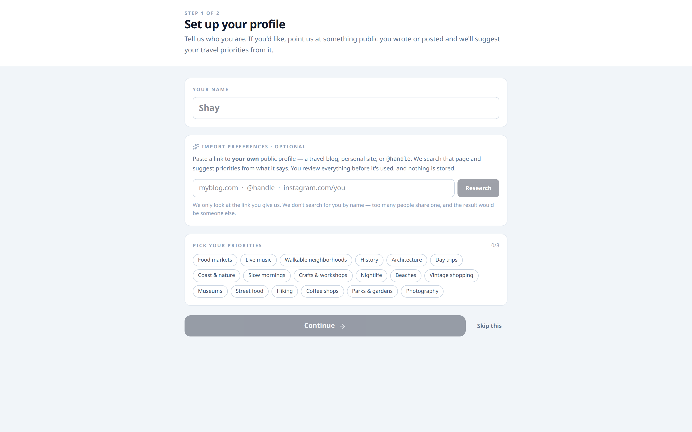
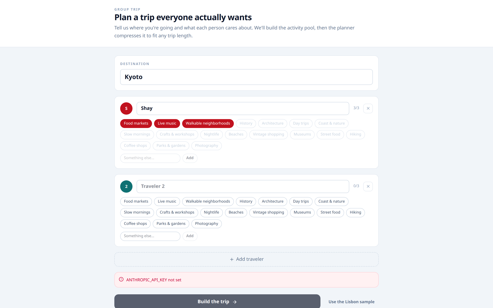
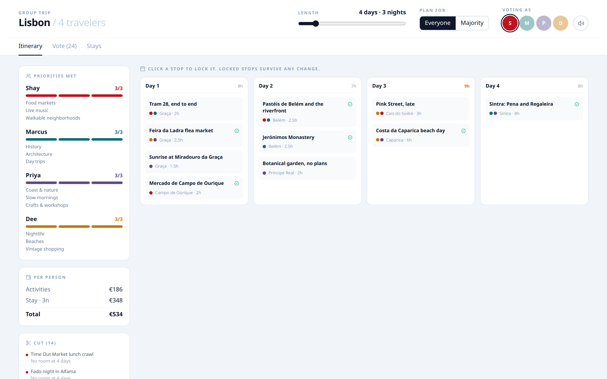
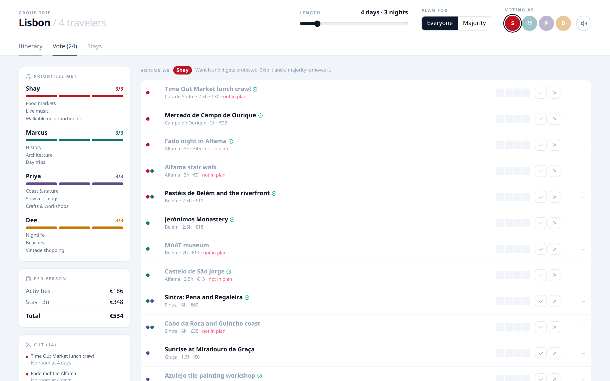
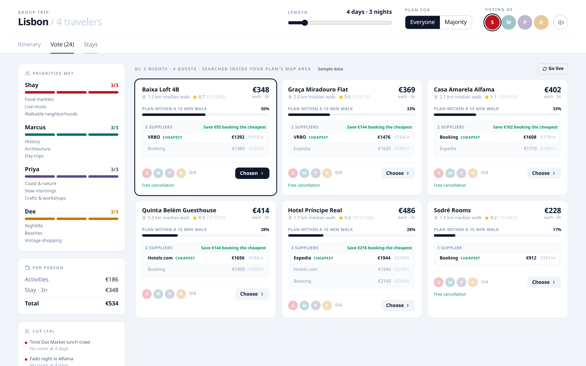

# Group trip planner

A browser app for planning a trip with more than one person. It builds an itinerary from a pool of activities, then shortens or lengthens that itinerary while showing whose priorities still fit, which stops were cut, and what each person would pay. The interface calls itself a group trip planner. The hackathon submission is [Tandem](https://devpost.com/software/tandem-teisr0).

With no API keys, the account and trip screens still work by hand, and **Use the Lisbon sample** opens a built-in four-person trip to Lisbon. Live generation, profile import, and hosted speech are optional route handlers in this repository.

## Hackathon

[Checkout](https://nyc-travel-hack.devpost.com/) was a one-day travel and hospitality hackathon in New York City on August 9, 2026, organized by [WanderWorth](https://wander-worth.com/checkout) and co-organized with Somya Gupta of localhost:nyc. Tandem was submitted that day as a group trip planner that adjusts an itinerary to the group's preferences and to a changing trip length.

The Devpost write-up lists the project as FastAPI and React, built with Claude and Codex, by Shay Bouchles, Robert McMurrer, and Mohammad Islam. This repository is the Next.js application. The backend repository is private.

Stay22, Tavily, and ElevenLabs are called from this app, and all three were supporters of Checkout. A comment at the top of `GroupTripPlanner.jsx` also names an AeroXplorer disruption banner. The planner itself renders three tabs: Itinerary, Vote, and Stays.

## What it does

The home page is one client component with three stages. The account and the trip live in React state until the tab closes.

**Account.** Ask for a name and up to three priorities from a shared chip list (`src/lib/priorities.js`). An optional import posts a public link, site, or `@handle` that the user supplies to `POST /api/profile`. The route refuses a bare personal name, because a name matches too many people. Tavily searches the target the user gave. Claude then maps the results onto the chip list. If Tavily returns pages and the Anthropic key is missing, or the model call fails, keyword matching suggests chips and marks the result `degraded`. The user confirms or edits the chips before they are used. **Skip this** leaves the profile empty.

**Trip setup.** Ask for a destination and up to six travelers, three priorities each, including a short custom label. The first traveler is filled from the account step when there is one. **Build the trip** posts to `POST /api/trip`. Traveler ids, priority ids, and colors are assigned in code. The model is asked only for the currency, the currency symbol, and 20–30 activities whose `tags` are those priority ids. Activities with no coordinates, or with no tags that match a real priority id, are dropped. **Use the Lisbon sample** skips that call and opens the planner on `DEFAULT_TRIP`.

**Planner.** `GroupTripPlanner.jsx` packs the pool locally on every slider, vote, and lock change.

- The length slider runs from 3 to 10 days. The packer budgets 8 hours a day. A stop that fits nowhere else lands on the lightest day, and that day's hour count turns amber when it passes 8. On the Lisbon sample at 4 days, day 3 is 9 hours.
- **Everyone** keeps filling the traveler who has the smallest share of priorities covered. **Majority** fills by how many priorities an activity covers per hour.
- Voting as one traveler marks a stop in or out. A majority out, larger than the in votes, removes it. In-votes are kept while hours remain. Clicking a stop locks it so later compression keeps it.
- The sidebar shows priorities met, a per-person total (activity prices plus the chosen stay), and the cut list with a reason for each drop.
- Days are grouped by neighborhood when the hours allow. Full-day stops (6 hours or more) stay in the plan and are left out of the stay-search box, so a day trip does not drag the hotel search across the region.
- **Stays** starts on six bundled Lisbon listings, labeled Sample data. **Go live** searches Stay22 inside the bounding box of the shorter stops, debounced, cached in memory, and replaced with the sample listings on a rate limit or any other error. Cards show the supplier price spread, a haversine median walk, and the share of planned hours within 1.2 km (labeled in the UI as a 15-minute walk). Travelers can vote on a stay. The search uses a fixed check-in of 12 September 2026.
- The speaker button posts a one-line summary to `POST /api/speak`. ElevenLabs audio is streamed back as `audio/mpeg`. If that route is unavailable, the button uses the browser's speech synthesis.

`activity.tags` stores priority **ids**, such as `shay-food`, and the packer joins on those ids.

## Screenshots

Taken from a local `next start` with no environment variables set. Generation and profile import were left on the missing-key path. The planner screens are the Lisbon sample, compressed to 4 days, with the bundled stay listings.











Below the `lg` breakpoint the sidebar stacks above the plan. That layout was checked at a 390px-wide viewport.

## Stack

| | |
|---|---|
| App | Next.js 16.3.0 App Router, React 19.2.8 |
| Styling | Tailwind CSS 4 |
| Icons | lucide-react |
| Trip generation and profile mapping | `@anthropic-ai/sdk`, model id `claude-opus-5` in the route handlers |
| Profile search | Tavily HTTP API |
| Speech | ElevenLabs `eleven_turbo_v2_5`, streamed |
| Stays | Stay22 `GET /v2/accommodations` from the browser |

`package.json` has no database client and no auth library.

## Architecture

```
src/app/page.js                  account → trip → planner, in memory
src/components/AccountSetup.jsx  name, optional import, priority chips
src/components/TripSetup.jsx     destination, travelers, Lisbon sample
src/components/GroupTripPlanner.jsx
                                 packTrip(), votes, locks, stays, speech
src/lib/priorities.js            chip list, palette, limits shared with the routes

POST /api/trip                   Anthropic → TRIP JSON
POST /api/profile                Tavily, then Anthropic or keyword matching
POST /api/speak                  ElevenLabs audio/mpeg
Stay22                           browser fetch only after Go live
```

`/api/trip` and `/api/profile` set `maxDuration = 60` so a long model call is less likely to be cut off on Vercel. Stay22 credentials are the `STAY22.apiKey` and `STAY22.aid` constants in `GroupTripPlanner.jsx`. Both are `null`, which the file treats as demo mode (the comment there says 5 requests per minute). `aid` is the affiliate id sent on the search when it is set. Listings stay in a `Map` on the client.

## Run it locally

Requirements: Node.js 22 was used for the install and production build in this repository. `npm ci` installs from the lockfile.

```bash
npm ci
cp .env.example .env.local   # optional; the file has names only
npm run dev
```

Open http://localhost:3000.

Without keys:

1. Enter a name, pick up to three priorities, and continue. Or choose **Skip this**.
2. On the trip screen, choose **Use the Lisbon sample**.

**Build the trip** and **Research** show the route's error when the matching key is absent (`ANTHROPIC_API_KEY not set`, `TAVILY_API_KEY not set`). Next.js reads `.env.local` at startup, so restart `npm run dev` after adding keys.

```bash
npm run build
npm start
```

## Environment

`.env.example` lists names only. Copy it to `.env.local` and fill values there. `.gitignore` ignores `.env*` and keeps `.env.example`.

| Variable | Read by | When it is unset |
|---|---|---|
| `ANTHROPIC_API_KEY` | `POST /api/trip`. Also the mapping step of `POST /api/profile`. | `/api/trip` returns 501. Profile import can still return keyword suggestions when Tavily succeeded, with `degraded: true`. |
| `TAVILY_API_KEY` | `POST /api/profile` | 501. The account screen still works; pick priorities by hand. |
| `ELEVENLABS_API_KEY` | `POST /api/speak` | 501. The speaker button uses browser speech synthesis. |
| `ELEVENLABS_VOICE_ID` | `POST /api/speak` | The route uses its built-in stock voice id. |

`/api/profile` validates the body before it checks for a key, so a bare name is rejected with 400 even when Tavily is unset. `/api/trip` checks for the Anthropic key first, so a request with a missing key returns 501 before body validation.

Stay22 credentials are the source constants above. To leave demo mode, set `STAY22.apiKey` and `STAY22.aid` in `src/components/GroupTripPlanner.jsx`.

## Scripts

| Script | Command |
|---|---|
| Dev server | `npm run dev` |
| Production build | `npm run build` |
| Serve the build | `npm start` |
| Lint | `npm run lint` |

## Repository layout

```
src/app/layout.js
src/app/page.js
src/app/globals.css
src/app/api/trip/route.js
src/app/api/profile/route.js
src/app/api/speak/route.js
src/components/AccountSetup.jsx
src/components/TripSetup.jsx
src/components/GroupTripPlanner.jsx
src/lib/priorities.js
docs/screenshots/
```

## Contributors

Git history for this repository is one commit, `216f8b9` (9 August 2026), authored by Shay Bouchles. That commit message includes a `Co-Authored-By` trailer for Claude Opus 5.

The Devpost submission also names Robert McMurrer and Mohammad Islam as creators of Tandem.

## Also true of this code

- `globals.css` locks the page to a light slate background.
- Activity coordinates feed the distance math and the stay-search box.
- A click locks a stop in place for later compression.
- Sample stay rows have an empty supplier URL, so they render as text. Live Stay22 rows link out through the URL the search returns.
- The repository ships without a test suite and without a `LICENSE` file.
